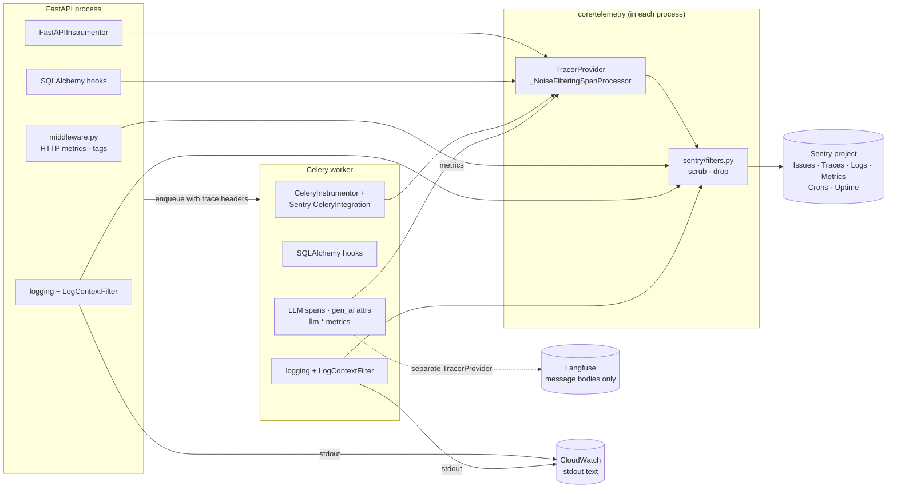
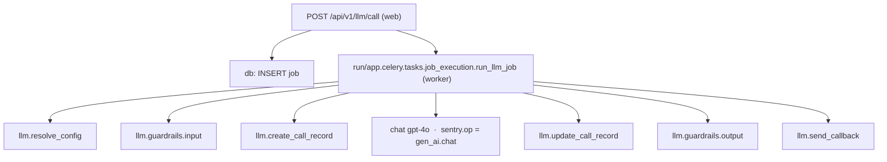
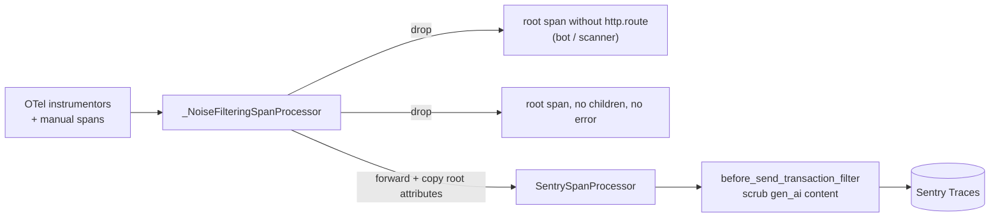

# Kaapi Observability — Architecture Overview

## Overview

Kaapi collects **traces, metrics and logs** from both processes, the FastAPI web app and the Celery worker, and sends all of them to **one Sentry project**. Errors and cron check-ins go to the same place, so one request can be followed from the HTTP call to the Celery task, the provider call and the callback.

- **OpenTelemetry creates spans, Sentry stores them** (`instrumenter="otel"`). Sentry's own span integrations are off, so nothing is recorded twice.
- **One package, `core/telemetry/`**, holds all of it. API and worker share one `init_sentry()`.
- **User data is redacted before it leaves the process.** Langfuse is the only place message bodies go.
- **Noise is dropped at the source:** bots, health checks and empty traces never reach Sentry.



---

## Setup

```
core/telemetry/
├── __init__.py      public API
├── tracing.py       tracer provider, span filtering, FastAPI instrumentation, flush
├── context.py       log context, per-module context, tenant tags, user binding
├── metrics.py       metric emitter, job and rate-threshold monitors
├── http.py          HTTP request metrics
├── llm.py           gen_ai span attributes, LLM metrics
├── db.py            SQLAlchemy spans and DB metrics
└── sentry/
    ├── init.py      one sentry_sdk.init() for API and worker
    └── filters.py   redaction and noise filters
```

- **One switch:** `OTEL_ENABLED` is checked only where instrumentation starts (`main.py`, `celery_app.py`, `core/db.py`). The telemetry functions themselves have no flags.
- **No double recording:** Sentry's FastAPI, Starlette, SQLAlchemy, httpx (and, on the API, Celery) integrations are disabled because OTel already covers them. The worker keeps Sentry's Celery integration for task-failure Issues.
- **Sampling** comes from settings, each validated to 0–1: `SENTRY_TRACES_SAMPLE_RATE`, `SENTRY_ERROR_SAMPLE_RATE`. Profiling is off: Sentry rate-limits profile chunks once the quota runs out, and the SDK then backs off and drops transactions too.
- **Environments:** production and staging report to separate Sentry projects (`kaapi-production`, `kaapi-staging`).

---

## 1. Tracing

**What is traced:** HTTP requests, DB queries, Celery tasks, S3/KMS (botocore), outbound HTTP, and every LLM call. These feed Sentry's ready-made views: **AI Insights** (LLM calls), **Queries** (DB), **Queues** (Celery) and **Outbound API Requests**. Redis is not instrumented: its spans were only Celery result-backend bookkeeping and rate-limit counters. The broker (RabbitMQ) shows only as Celery's `apply_async` span, which links the API request to the worker trace.

**Waterfall of one `/llm/call`**, as it appears in Sentry:



**What each span carries:**

- **LLM (`chat <model>`):** provider, model, operation, request params (temperature, max tokens, top_p, tools), token usage including reasoning tokens, response model, org and project.
- **DB:** parameterised SQL (`db.statement`), rows affected (`db.rows_affected`), and on failure the Postgres SQLSTATE with a readable name for deadlocks, lock timeouts, serialization failures and connection errors.
- **Callback (`llm.send_callback`):** payload size, client HTTP status and duration.
- **HTTP server span:** method, route, status and request body size.

**How it is done:**



- **One trace from API to worker:** OTel's Celery instrumentation carries the trace on enqueue and parents the worker's `run/...` span to `apply_async`; task spans nest under `run/...`. Trace context is never injected or attached by hand: doing so reparented task spans to the API request and split them into separate Sentry transactions. Self re-enqueuing poll loops start a fresh trace so one trace does not span hours.
- **Root attributes are kept:** Sentry's processor copies attributes only for child spans; ours copies root-span attributes too.
- **Provider HTTP spans are suppressed** inside LLM calls, since the `chat <model>` span already covers the call.
- **Spans are flushed** after every Celery task and in LLM job `finally` blocks, so a recycled worker does not lose them.
- **Langfuse is kept apart:** it runs on its own tracer provider, so LLM message bodies go to Langfuse and never into Sentry traces.

---

## 2. Metrics

All metrics go through `emit_sentry_metric()`, which never raises and does nothing when Sentry is off.

| Family | Metrics |
|---|---|
| **HTTP** | `http.server.request.count`, `.duration`, `.body.size`, `.error`, `.unmatched` |
| **DB** | `db.query.failed` (tagged by Postgres SQLSTATE), `db.query.slow` (≥ `DB_SLOW_QUERY_MS`), `db.connection.opened/closed/invalidated`, `db.transaction.commit/rollback` (rollback ratio), `db.pool.active/idle/total/overflow` (pool saturation) |
| **LLM** | `llm.call.count`, `llm.call.duration`, `llm.call.error`, `llm.tokens.input/output/total` (by provider and model) |
| **Jobs** | `jobs.pending.stale.count`, `jobs.pending.oldest_age_seconds` (table-level and by job type) |

Metrics use the Sentry SDK directly because Sentry does not ingest OpenTelemetry metrics.

---

## 3. Logs

Every log line goes to two places with the same content:

| Sink | What you see | Search |
|---|---|---|
| **Sentry Logs** | structured fields: `message`, `log_module`, `logger.name`, `code.line.number`, tenant tags, link to the trace | `log_module:llm-call` |
| **CloudWatch** | one text line from container stdout | `filter @message like "[llm-call]"` |

```
2026-10-11 10:16:57,137 - [kaapi-backend] - [a1b2c3] - INFO - [knowledgebase] app.api.routes.collection_job - [get_collection_job] Fetched job | job_id=8f2c
```

**Log context.** `log_context(...)` wraps a request or task and adds fields (`job_id`, `project_id`, `lifecycle`, …) to every log line inside it, including lines from shared helpers. After auth, the org and project ids are added the same way. `LogContextFilter` applies these fields; it is installed with logging, so it works even when tracing is off.

**Per-module context.** Every line from a known module carries `log_module` (for example `llm-call`), and the CloudWatch line shows it in front of the logger name:

| Module | Covers |
|---|---|
| `knowledgebase` | collections, documents, doc transformation, RAG |
| `llm-call` | `/llm/call`, `services/llm`, `crud/llm` |
| `llm-chain` | `/llm/chain`, `services/llm/chain`, `crud/llm_chain` |
| `config-version` | config routes and CRUD |
| `assessment` | API-client BATCH path and submissions |
| `evals` | evaluations v2: routes, judge, iteration loop, prompt improvement |
| `fastevals` | fast evaluations |

- The module comes from a file-to-module map (`_LOGGER_MODULES` in `context.py`).
- When a flow runs another flow's code, it sets the module itself with `log_context(module=LogModuleEnum.X)`: LLM chain jobs and fast-eval tasks do this.
- Files outside these modules have no `log_module`, and their CloudWatch line shows just the logger name.

---

## 4. HTTP

- **Spans:** `FastAPIInstrumentor` creates one server span per request. Health checks, docs/OpenAPI paths and cron endpoints are excluded, and ASGI `http send` / `http receive` spans are never created. Spans carry both old and stable `http.*` names (`OTEL_SEMCONV_STABILITY_OPT_IN=http/dup`).
- **Middleware (`core/middleware.py`):** times each request, reads the body size from `Content-Length`, tags the Sentry scope with method, route, status and `correlation_id`, and writes one access log line.
- **Metrics:** count, duration, body size and errors per method, route and status.
- **Bots and scanners:** requests that match no route (random paths, `PROPFIND`, `SEARCH`, …) are dropped from traces, get no access log and no per-route metrics; only `http.server.request.unmatched` is counted.

---

## 5. Errors, crons and alerts

- **Unhandled API errors:** the generic 500 handler reports the exception to Sentry. 4xx responses are not reported.
- **Celery task failures:** become Issues with the task name and (redacted) arguments.
- **Error logs:** any `logger.error` / `logger.exception` becomes a Sentry event.
- **Callbacks:** every callback logs url, status, duration, size and payload (without `data`); failures log at ERROR.
- **Tenant impact:** each Issue is tagged with org and project and bound to the calling user, so it shows which tenants are affected.
- **DB errors:** tagged with the Postgres SQLSTATE and a readable name (`deadlock_detected`, `lock_not_available`, `too_many_connections`, …), so DB Issues can be grouped by cause.
- **Breadcrumbs:** the last 30 log lines and calls before an error are attached to it.
- **Rate threshold:** a project exceeding its per-minute limit raises a warning event tagged `alert.type=threshold_rate_monitor`.
- **Crons:** `evaluation-cron-job`, `pending-jobs-monitor` and `daily-stats-cron-job` check in with `@sentry_sdk.monitor`; a missed or failed run is flagged.
- **Alerts and uptime:** alert rules, uptime monitors (API, console, guardrails) and dashboards are configured in the Sentry UI.

---

## 6. Redaction

- **Prompts and completions:** `gen_ai.*`, `ai.*` and Langfuse content keys are removed from every event, transaction and log.
- **Request body:** always replaced with `[REDACTED]` on error events, because on LLM routes it is the user's message.
- **Headers, cookies, query string:** `Authorization`, `Cookie`, `X-API-KEY` and the query string are redacted while `SENTRY_SEND_DEFAULT_PII` is off.
- **LLM and chain task arguments:** the user `query` and every config `instructions` value are redacted. Model, params, `request_metadata` and `callback_url` are kept.
- **Callback payload:** the `data` field (LLM output) is left out of callback logs.
- **Stack frames:** local variables are not sent (`include_local_variables=False`).
- **Sentry AI integrations:** pinned to `include_prompts=False`, so the SDK never records prompts on its own.
- **Log lines on LLM paths:** by convention they log ids, lengths and types, never prompt or response text.

---

## Where to start reading

1. [core/telemetry/__init__.py](../../backend/app/core/telemetry/__init__.py) — the public surface.
2. [core/telemetry/sentry/](../../backend/app/core/telemetry/sentry/) — `init.py` (what is sent) and `filters.py` (what is redacted).
3. [core/telemetry/tracing.py](../../backend/app/core/telemetry/tracing.py) and [context.py](../../backend/app/core/telemetry/context.py) — span filtering, log context and modules.
